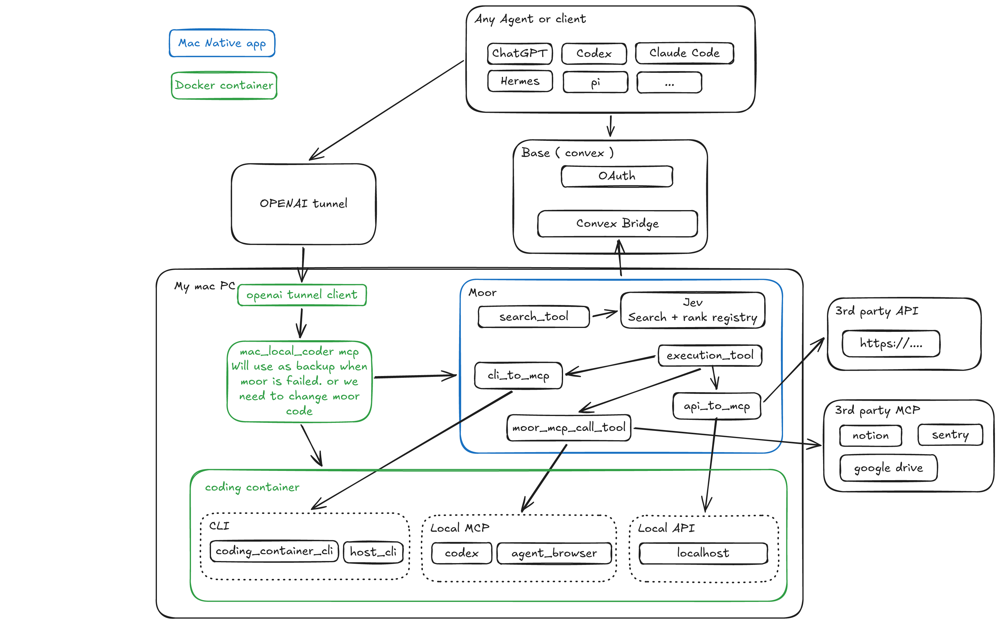

# Mac-local MCP architecture (target)

This document records the **intended** architecture for the Specdest Moor fork. Some adapters and isolation rules shown in the diagram are not implemented yet.



**Editable source of truth:** [`my_local_structure.excalidraw`](../my_local_structure.excalidraw). The PNG above is a generated preview. After changing the diagram, regenerate it from the repo root:

```bash
excalidraw-cli convert my_local_structure.excalidraw --format png \
  -o docs/assets/my_local_structure.png --scale 2
```

## Components and ownership

| Component                                        | Location                 | Responsibility                                                                                                                       |
| ------------------------------------------------ | ------------------------ | ------------------------------------------------------------------------------------------------------------------------------------ |
| Agents (ChatGPT, Codex, Claude Code, Hermes, Pi) | Remote or local          | Choose tools, submit MCP calls and consume results.                                                                                  |
| Base OAuth + Convex bridge                       | Hosted Base/Convex       | Authenticate user/client, authorize and queue bridge operations, relay results. **No Moor configurations or tool settings in Base.** |
| Moor                                             | Native macOS app (blue)  | Owns MCP configuration, profile mappings, per-server instructions, tool registry/search, permissions, credentials and auditing.      |
| CLI-to-MCP                                       | Moor adapter (planned)   | Expose approved CLI operations in the coding container as callable tools.                                                            |
| API-to-MCP                                       | Moor adapter (planned)   | Expose configured local and third-party HTTP API operations as tools.                                                                |
| MCP-to-MCP                                       | Existing Moor dispatcher | Route permitted tool calls to local and remote MCP servers.                                                                          |
| Coding container                                 | Docker (green)           | Runs developer CLIs, approved host-gateway commands, local MCPs and local APIs.                                                      |
| OpenAI tunnel + mac_local_coder                  | Independent backup path  | Retain development/recovery access when Moor fails.                                                                                  |

**Color convention:** Blue = native Mac app; each green rectangle = its own Docker container. Dotted boxes inside the coding container are **logical groups**, not individual containers.

## Request flow (ordered)

1. An agent signs in through **Base OAuth** and calls Base's hosted MCP endpoint.
2. Base identifies the user and OAuth client and authorizes bridge access; the paired connector uses **Moor-owned agent-to-profile configuration** to route the request. Unassigned clients fail closed.
3. Moor maintains an **outbound Convex subscription**. It claims a queued MCP request and returns the correlated response to Convex. No inbound public Mac listener is required for this path.
4. In **Curated listing** mode, the agent sees `moor_search_tools` and `moor_mcp_call_tool` (plus pinned tools). `moor_search_tools` searches permitted tools and returns descriptions, names, input schemas, risk labels and applicable per-server instructions. **Search does not execute a tool or register client-native tools dynamically.**
5. The agent calls `moor_mcp_call_tool` with a returned name and arguments (`moor_call_tool` remains a callable legacy alias). The diagram's `execution_tool` means Moor's **internal dispatcher**, **not an additional public tool**.
6. Moor resolves the profile and tool, applies enabled/disabled and risk policies, records audit context, then dispatches to one adapter:
   - **CLI-to-MCP:** Only approved CLI operations in the coding container, including controlled host-gateway commands.
   - **API-to-MCP:** Configured local (container-reachable) APIs or remote HTTPS APIs.
   - **MCP-to-MCP:** Standard MCP tool calls to local (Codex/browser) or remote (Notion/Sentry/Drive) MCP servers.
7. The tool result goes back through Convex to Base and then to the agent.

The **separate direct local Moor profile endpoint** uses a Moor-issued bearer token, not a Base OAuth token. The primary flow above uses Base OAuth and the outbound bridge.

## Recovery and operating boundaries

- **Moor unavailable:** The separate OpenAI tunnel and `mac_local_coder` provide a development/recovery path to the coding container. Fallback is agent-selected, **not automatic**.
- **Mac/container offline:** Local tools cannot execute; Base-hosted tools may continue independently.
- **Timed-out writes:** Do not blindly replay: an operation might have executed before the response was lost.
- **Container networking:** `localhost` inside the coding container refers to the container, not Moor or another container. Use container-reachable addresses for local APIs/MCPs.
- **Host CLI:** Use existing approved command interfaces only; do not introduce unrestricted shell execution in CLI-to-MCP.
- **Isolation:** Moor is a native macOS process, so “only the three adapters access external resources” is a **code-level boundary** until enforced by process/OS sandboxing.

## Implementation status

| Area                                                                                                                           | State                                                                                                                                                    |
| ------------------------------------------------------------------------------------------------------------------------------ | -------------------------------------------------------------------------------------------------------------------------------------------------------- |
| Native Moor app; local/remote MCP management; stdio/`npx`; downstream OAuth                                                    | **Existing**                                                                                                                                             |
| Profiles, tool permissions, per-MCP instructions, `moor_search_tools`, `moor_mcp_call_tool` with legacy alias, keyword ranking | **Existing**                                                                                                                                             |
| Base OAuth → Convex → Moor outbound connector                                                                                  | **Implemented**; production multi-agent/profile E2E acceptance pending                                                                                   |
| OpenAI tunnel → independent `mac_local_coder` backup                                                                           | **Existing**                                                                                                                                             |
| Jev-style OpenRouter ranker                                                                                                    | **Implemented (opt-in)**; configured in Moor Settings and stored using macOS Keychain; deterministic fallback                                            |
| Built-in CLI-to-MCP adapter                                                                                                    | **Implemented in Moor**; requires a separately approved `execute_approved_cli` container executor and registered command approvals before live execution |
| Built-in API-to-MCP adapter                                                                                                    | **Implemented in Moor** with owner-only REST configuration; dedicated UI editor not implemented                                                          |
| Strict core-vs-adapter isolation enforced by OS/process sandbox                                                                | **Not implemented**                                                                                                                                      |

See [Base connector](base-connector.md) for bridge setup and its verification status, and [Agent profiles](agent-profiles.md) for direct Moor MCP endpoints.
